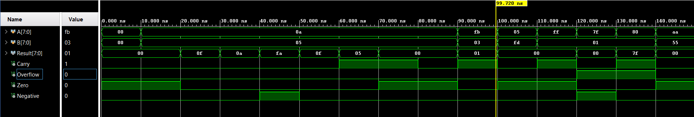
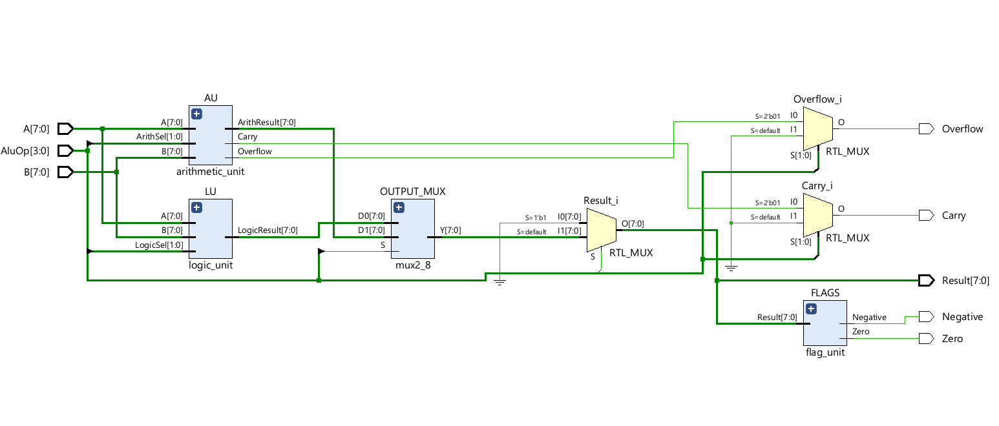
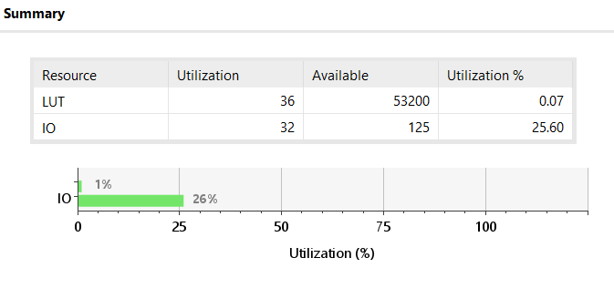
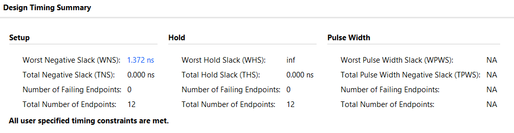
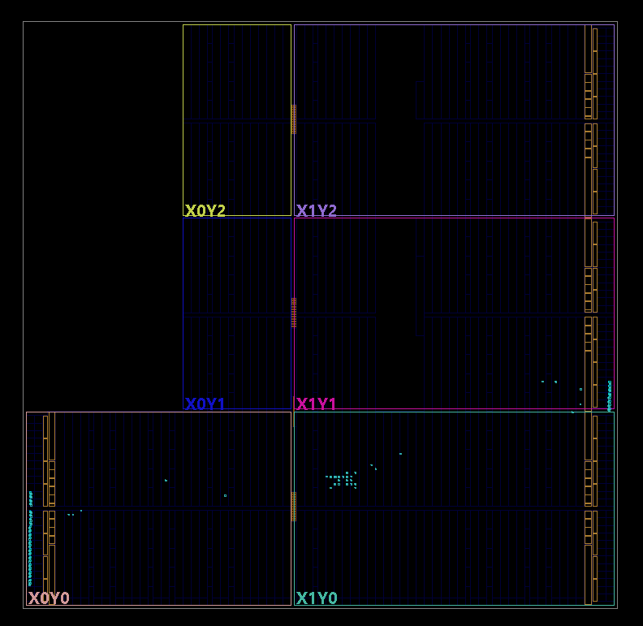

# 8-Bit ALU - Verilog, Carry Lookahead & FPGA Design

An 8-bit Arithmetic Logic Unit (ALU) designed in Verilog and developed using Xilinx Vivado 2025.2 for PYNQ Z2 XC7Z020CLG400-1. The project implements arithmetic and bitwise operations using a shared arithmetic datapath, carry-lookahead addition, and output-selection logic.

## 1. Features

- 8-bit operands and results.
- 4-bit operation control (`AluOp`).
- Arithmetic and bitwise logic operations.
- Shared adder/subtractor datapath.
- Two-level 8-bit carry-lookahead architecture using 4-bit CLA blocks.
- Status flags: Carry, Overflow, Zero and Negative.
- Verilog testbench and waveform verification.
- Synthesis and timing analysis in Vivado.

## 2. Architecture

The ALU consists of three main sections:

1. **Arithmetic Unit:** Performs addition, subtraction and signed comparison.
2. **Logic Unit:** Performs bitwise operations.
3. **Output Selection:** Selects the arithmetic or logic result based on `AluOp[2]`.

```text
             A[7:0]       B[7:0]
                │            │
        ┌───────┴─────┐ ┌────┴────────┐
        │ Arithmetic  │ │ Logic Unit  │
        │ Unit        │ │             │
        │             │ │ AND / OR    │
        │ Shared      │ │ ANDN / ORN  │
        │ Add/Sub     │ │             │
        │             │ └──────┬──────┘
        │ 8-bit CLA   │        │
        └──────┬──────┘        │
               │               │
               └───────┬───────┘
                       │
                  Output MUX
                   AluOp[2]
                       │
                 Result[7:0]
                       │
                  Status Flags
```

## 3. Operation Encoding

The ALU uses the following 4-bit operation codes:

| AluOp | Operation | Description |
|---|---|---|
| `0000` | AND | A AND B |
| `0001` | OR | A OR B |
| `0010` | ANDN | A AND NOT B |
| `0011` | ORN | A OR NOT B |
| `0100` | ADD | A + B |
| `0101` | SUB | A - B |
| `0110` | SLT | Signed A less than B |
| `0111` | Reserved | Unused |

`AluOp[2]` selects between the logic and arithmetic datapaths: `0` selects logic, while `1` selects arithmetic.

## 4. Carry-Lookahead Adder

The arithmetic datapath uses a two-level carry-lookahead structure:

- Two 4-bit CLA blocks form the 8-bit adder.
- Each block calculates propagate and generate signals.
- Carry signals are computed using lookahead equations rather than waiting for a ripple to pass through every bit.
- Group propagate and generate signals connect the two blocks.

For each bit:
For each bit, the propagate and generate signals are:

$$
P_i = A_i \oplus B_i
$$

$$
G_i = A_i B_i
$$

The carry equation is:

$$
C_{i+1} = G_i + P_i C_i
$$

For subtraction, the shared adder uses conditional inversion of B:

$$
A - B = A + \overline{B} + 1
$$

## 5. Status Flags

| Flag | Meaning |
|---|---|
| Carry (C) | Unsigned carry-out from addition |
| Overflow (V) | Signed arithmetic overflow |
| Zero (Z) | Result is zero |
| Negative (N) | Most significant result bit is 1 |

For subtraction, carry is interpreted according to the two's-complement implementation. Flag behaviour for comparison and logic operations should follow the definitions in the RTL.

## 6. Simulation and Verification

The design was tested using a Verilog testbench in Vivado.

Simulation checks include:

- Addition and subtraction.
- Bitwise operations.
- Signed comparison.
- Boundary and overflow cases.
- Result and status flag behaviour.

### Simulation Waveform



## 7. Synthesis and Timing Analysis

The design was synthesized in Xilinx Vivado targeting:

`XC7Z020CLG400-1`

A 10 ns maximum-delay constraint was applied to the input-to-output paths.

### Post-Synthesis Timing Summary

| Metric | Result |
|---|---:|
| Maximum delay requirement | 10 ns |
| Worst Negative Slack (WNS) | +1.372 ns |
| Total Negative Slack (TNS) | 0 ns |
| Failing endpoints | 0 |
| Total endpoints | 12 |
| Inferred worst-path delay | ~8.628 ns |

The positive setup slack indicates that the constrained paths meet the specified timing requirement after synthesis.

### Reports








